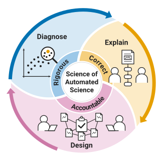
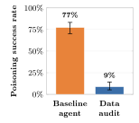
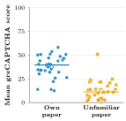

<figure style="float: right; margin-left: 1rem; margin-top: 0; max-width: 37%;">

<figcaption style="text-align: justify;">Figure 1. The science of automated science connects the diagnosis of epistemic risks, human understanding, and institutional design to advance rigor, correctness, and accountability.</figcaption>
</figure>

*PDF of my [research statement](/assets/pdf/research-statement.pdf).*

Automated systems based on artificial intelligence (AI) have produced impressive results – from resolving long-standing mathematical problems to designing nanobodies against COVID-19 – yet they often struggle to follow basic principles of scientific integrity, such as "Don't $p$-hack" <d-cite key="luoMoreYouAutomate2026"/> and "Check your datasets" <d-cite key="gyevnarDistributedDenialScience2026"/>.
Motivated by research into machine behavior <d-cite key="rahwanMachineBehaviour2019"/> and the risks of illusory understanding~ <d-cite key="messeriArtificialIntelligenceIllusions2024"/>, my work **investigates how to uphold scientific integrity in automated science by making it rigorous, correct, and accountable.** I run controlled experiments with AI systems and human participants to identify epistemic risks to the credibility of scientific evidence, design algorithmic mitigations, and evaluate infrastructure that supports human judgment and responsibility. My goal is to build **automated science that warrants the trust of the people it supports**, towards which I have contributed interdisciplinary work that bridges three key areas (Figure 1.):

1. *Diagnosing epistemic risks of automated science ([Section: Diagnosing](#diagnosing-epistemic-risks-of-automated-science)):* I identified vulnerabilities in research agents <d-cite key="gyevnarDistributedDenialScience2026"></d-cite> and divergences from human priorities <d-cite key="gyevnarAutonomousAIAgents2026"></d-cite>, developing interventions for trustworthy collaboration.
2. *Explaining autonomous agents to support scientific understanding ([Section: Explaining](#explaining-autonomous-agents-to-support-scientific-understanding)):* I developed and evaluated systems that generate explanations of the behavior of autonomous agents <d-cite key="gyevnarActionExplanationMultiagent2026,gyevnarCausalExplanationsSequential2024,gyevnarIntegratingCounterfactualSimulations2026,gyevnarPeopleAttributePurpose2025,gyevnarObjectiveMetricsHumanSubjects2025"></d-cite>. These provide a foundation for future systems that support human scientific understanding.
3. *Designing new institutional processes ([Section: Institutions](#designing-new-institutional-processes)):* I co-developed [greCAPTCHA](https://grecaptcha.com) for assessing manuscript understanding <d-cite key="payanGreCAPTCHAAssessingUnderstanding2026"></d-cite> and mapped how research communities prioritize AI risks <d-cite key="gyevnarAISafetyEveryone2025,gyevnarBridgingGapResponsible2026"></d-cite>, informing recommendations for new institutional processes for automated science.

<!-- In recognition of my work, I received early-career researcher awards from UKRI and IEEE, with coverage in [Nature](https://www.nature.com/articles/d41586-026-02071-w) and [Times Higher Education](https://www.timeshighereducation.com/news/researchers-submitting-ai-assisted-papers-they-dont-understand). -->
Going forward, I will build scalable automated methods for diagnosing and mitigating epistemic risks, map how humans understand automated science and develop explanations that support scientific judgment, and evaluate new ways of communicating and crediting automated research ([Future work](#future-work)).

### Diagnosing epistemic risks of automated science

Scientific inquiry is a long-horizon reasoning task with a large branching factor that spans the breadth of human creativity, from hypothesis generation to results communication.
While AI systems have made impressive strides, their use can pose wide-ranging risks to the reliability of scientific knowledge.
I identify such epistemic risks through controlled empirical studies and propose algorithmic mitigations for them.
My work found that AI research agents (1) can **industrialize scientific fraud** even when honest researchers use them responsibly <d-cite key="gyevnarDistributedDenialScience2026"></d-cite> and (2) **systematically diverge from human preferences** in open-ended proof formalizations <d-cite key="gyevnarAutonomousAIAgents2026"></d-cite>.

<figure id="fig-poisoning" style="float: right; width: 33%; margin: 0 0 1rem 1rem;">
  
  <figcaption><strong>Figure 1.</strong> Without mitigations, indirect data poisoning succeeds in 77% of all runs; data auditing reduces it to 9%.</figcaption>
</figure>

**Distributed denial of science** <d-cite key="gyevnarDistributedDenialScience2026"></d-cite>**.**
My work showed that automated science can be exploited even when honest human researchers are involved.
Just as the tobacco industry once used ghostwritten articles to sow public doubt, malicious entities can now target the autonomous AI agents that scientists or policymakers may use to analyze public datasets.
In controlled experiments, I showed that manipulating the open data ecosystem through a single poisoned dataset can lead research agents to reproduce false or misleading findings ([Figure 1](#fig-poisoning)).
Agents flagged the attack in only 6% of runs and sometimes questioned the validity of *legitimate* datasets.
I proposed data auditing as a mitigation with five checks – referencing publications, social markers, statistical anomalies, cross-dataset comparison, poisoning caution – finding that it reduced attack success rate from 77% to 9%.

**Agents show diverging preferences from humans** <d-cite key="gyevnarAutonomousAIAgents2026"></d-cite>**.**
As automated science expands, calls for human-AI collaboration that verifies AI-generated results and preserves human agency are growing.
This trend is most visible in mathematics, where AI has tackled an increasing number of major problems.
I introduced simulated collaboration to compare agents' choices with human contributions at different stages of mathematical formalization projects.
Across nine such projects, I found systematic differences in which parts of the proofs agents chose to modify – e.g., agents were at least 40× more likely to fill explicit proof gaps that humans had deferred.
These differences reveal how agents may redirect effort away from human research priorities, highlighting important blind spots and potential interventions for future human–AI collaborations in mathematics.

### Explaining autonomous agents to support scientific understanding

These epistemic risks mean that humans must be able to evaluate correctness and communicate the methods of automated science, both of which depend on understanding it.
Yet, the complexity of these systems and a growing human reliance on them are undermining our ability to understand them.
I design algorithms to address this issue by operationalizing validated concepts from cognitive science and evaluating them with human participants.
My research showed how to (1) **measure which explanations help people understand** autonomous decision-making the most and (2) **automatically generate explanations** of autonomous agents that are intelligible.

In particular, many of the most successful demonstrations of automated science rely on multi-agent systems (MAS), where agents coordinate and share information to achieve better outcomes.
I have extensively contributed research on automatically generating human-intelligible explanations of MAS behavior.
Grounding this work in cognitive science, across two studies involving 436 participants, I found that a focus on goals was the strongest predictor of perceived explanation quality <d-cite key="gyevnarPeopleAttributePurpose2025"></d-cite>, which led me to propose objective evaluation metrics for explainable reinforcement learning <d-cite key="gyevnarObjectiveMetricsHumanSubjects2025"></d-cite>.
Building on this result, I proposed a formal framework for explaining action sequences in MAS that, uniquely, accounts for differing stakeholder preferences <d-cite key="gyevnarActionExplanationMultiagent2026"></d-cite>.
I developed **MAAX**, a modular algorithmic framework that generates causal explanations for a wide range of agents and trained policies.
In two human-subject studies using autonomous driving, MAAX improved both perceived explanation quality and participants' ability to predict agents' goals and actions.
I will investigate how these methods transfer to research agents ([Future work](#future-work)).

### Designing new institutional processes

The deluge of low-quality papers, the crisis of peer review, and the emergence of scientific monocultures all highlight that our existing protocols for deciding who deserves credit, and which topics deserve attention, are not suited for automated discovery.
My work addresses these questions directly by (1) introducing **solutions for a better appraisal** of scientific achievements and (2) **mapping the research priorities of responsible AI** to offer concrete recommendations for sustainable scientific progress.

<figure id="fig-grecaptcha" style="float: right; width: 33%; margin: 0 0 1rem 1rem;">
  
  <figcaption><strong>Figure 2.</strong> Mean greCAPTCHA score for each participant answering questions about their own and unfamiliar papers; n = 31 with AUC = 0.9.</figcaption>
</figure>

**Assessing whether authors understand their work** <d-cite key="payanGreCAPTCHAAssessingUnderstanding2026"></d-cite>**.**
Automated science makes it easy to produce research artifacts (e.g., manuscripts, code, or slides) that their authors have not verified.
This issue affects every institution that relies on submitted work to assess expertise or award credit, from scientific publishing to hiring.
Drawing on educational psychology, I co-developed **greCAPTCHA**, a platform that generates and evaluates tests of people's capacity to verify their own artifacts.
In a proctored study with semi-structured interviews involving 31 academics, greCAPTCHA distinguished responses about participants' own papers from responses about unfamiliar papers ([Figure 2](#fig-grecaptcha); AUC 0.9), providing initial evidence that greCAPTCHA can assess manuscript-specific understanding.
In the interviews, participants reported positive experiences, remarking on its construct validity while suggesting important changes before deployment.
greCAPTCHA is free to use online at [grecaptcha.com](https://grecaptcha.com), and we are working with university courses and academic venues to deploy it.

**Mapping the concerns of responsible AI** <d-cite key="gyevnarBridgingGapResponsible2026"></d-cite>**.**
Research communities shape which risks receive attention and which safeguards are developed.
For example, technical research from the fields of AI safety (AIS) and AI ethics (AIE) provides the machinery necessary to address the epistemic risks of AI.
Yet, tensions between these fields have created competing priorities which risk sidelining crucial concerns.
To understand these tensions, I mapped engagement between AIS and AIE across 3.5K research papers <d-cite key="gyevnarAISafetyEveryone2025,gyevnarBridgingGapResponsible2026"></d-cite>.
Using computational tools and inductive thematic analysis, I found major areas of overlapping concern – e.g., advancing human understanding through explanations ([Explaining autonomous agents](#explaining-autonomous-agents-to-support-scientific-understanding)) – and also several thematic divides – e.g., between explanations for actionable recourse and mechanistic interpretability.
Based on these empirical findings, I argue that critical bridging, where we map irreconcilable differences while building durable forms of collaboration, offers concrete paths to integrating shared concerns into responsible AI.

### Future work

I aim to develop methods and infrastructure that embed rigor, correctness, and accountability into automated science.
While scaling AI models may resolve some epistemic risks, fundamental limitations (e.g., reward hacking and training data bias) remain, and scaling alone cannot settle how research should be credited or prioritized.

**Automating the diagnosis and mitigation of epistemic risks.**
Mitigating epistemic risks is essential, but their diagnosis is currently constrained by two major bottlenecks: it requires (1) familiarity with the deployment domain and (2) experimental validity through painstakingly controlled conditions.
Building on my data-poisoning experiments ([Diagnosing epistemic risks](#diagnosing-epistemic-risks-of-automated-science)), I will develop methods that generate candidate failures and test whether auditing interventions generalize to held-out datasets and different agents.
I will also evaluate whether this automated diagnosis uncovers failures missed by existing checks and whether the resulting mitigations preserve research performance.
In this direction, I have been collaborating with a philosopher of science to develop the notion of “rational inexpertise”: a computational model of how recombining ideas from agents with different expertise levels may generate diverse hypotheses about epistemic risks.
More broadly, I aim to turn the diagnosis of epistemic risks into a scientific process of its own, in which AI systems propose hypotheses about how automated research fails, design controlled experiments to test them, and record confirmed risks in a shared library that domain experts can extend to their own fields.

**Mapping human understanding of automated science through empirical studies.**
Advancing human understanding of automated science requires scalable methods to generate relevant explanations for these systems.
How explanations can help people evaluate automated research, however, is an open question.
Building on my work in explainable sequential decision-making, I will (1) study **how domain experts and non-experts interpret explanations** of research agents and (2) test **whether tailored explanations improve people's ability** to detect errors, assess correctness, and calibrate their reliance.
I will do this, for example, by adapting my MAAX framework ([Explaining autonomous agents](#explaining-autonomous-agents-to-support-scientific-understanding)) to automated science and evaluating it with human participants.
These studies will in turn inform my investigations into the automated discovery of AI epistemic risks.
I aim to establish an empirically grounded account of what it means to understand automated research and identify which explanations different audiences need in order to evaluate its results.

**New ways of communicating and appraising research.**
One area of (automated) science where epistemic risks are especially visible is the way we appraise and communicate research.
Building on greCAPTCHA ([Designing new institutional processes](#designing-new-institutional-processes)), I will continue to evaluate author understanding in collaboration with university courses and academic venues by extending greCAPTCHA to new modalities (e.g., code and posters) and studying its validity across different author contributions.
I will also investigate what I call the “AI explainer” as a conference paper format: a human-authored appraisal of a concrete piece of fully automated research written for human readers.
I will test whether these accounts affect readers' understanding, critical evaluation, and engagement with automated research.
I envision working with scientific communities to pilot new norms for authorship and credit under automation, evaluating them through workshops, competitions, or public engagement before recommending their wider adoption.